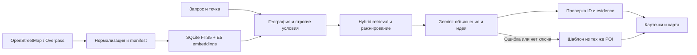

# Как устроен подбор

Сбор выполняется отдельной командой. В пользовательском запросе используется локальный индекс, а не Overpass. Датасет, исходный snapshot и manifest позволяют проследить происхождение места.

До финального top-k проверяются область, расстояние и строгие условия. Так общегородские популярные результаты не вытесняют ближайшие места. Отрицания и обязательные свойства имеют приоритет перед текстовой близостью.

Семантическая часть использует multilingual-e5-small с `query: ` и `passage: `, нормализацией векторов; лексическая — SQLite FTS5/BM25. Списки объединяются по ранговому принципу. Индекс связан с хешем датасета и revision модели.

Названия, адреса, координаты, источники, расстояния и время берутся сервером из данных и расчётов. Генератор получает ограниченный набор кандидатов и возвращает их ID, объяснения, evidence и идеи. Неизвестный ID или неподтверждённое обещание не должны пройти проверку. POI — недоверенные данные, даже если в их тексте встречается инструкция.

Модель может предложить занятие, но не новую услугу, цену, событие или доступ на закрытую территорию. При ошибке генерации ответ строится из тех же проверенных кандидатов и отмечается как поиск без генерации. При отсутствии embeddings текстовый режим маркируется отдельно.

В текущем MVP генерация намеренно ограничена: Gemini выбирает/упорядочивает кандидатов и выбирает из разрешённых идей по категории. Объяснение `why_suitable` детерминированно строится сервером из evidence и должно совпасть с разрешённой строкой; это не свободный текст, сочинённый моделью. Такой контракт снижает риск неподтверждённых обещаний, но ограничивает разнообразие ответа.

Прямая дистанция служит предварительным фильтром. Без маршрутизатора она не превращается в обещание времени дороги или гарантированный маршрут через городские барьеры. Неизвестное расписание не означает «открыто».

Точные реализованные режимы и измерения зафиксированы в [verification.md](verification.md).
