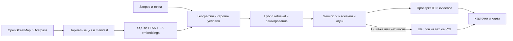

# Как устроен подбор

Сбор выполняется отдельной командой. В пользовательском запросе используется локальный индекс, а не Overpass. Датасет, исходный snapshot и manifest позволяют проследить происхождение места.

До финального top-k проверяются область, расстояние и строгие условия. Так общегородские популярные результаты не вытесняют ближайшие места. Отрицания и обязательные свойства имеют приоритет перед текстовой близостью.

Семантическая часть использует multilingual-e5-small с `query: ` и `passage: `, нормализацией векторов; лексическая — SQLite FTS5/BM25. Списки объединяются по ранговому принципу. Индекс связан с хешем датасета и revision модели.

Названия, адреса, координаты, источники, расстояния и время берутся сервером из данных и расчётов. Генератор получает до трёх кандидатов, распознанные темы и ограничения. Исходный пользовательский текст не передаётся. POI — недоверенные данные, даже если в их тексте встречается инструкция.

Модель может предложить занятие, но не новую услугу, цену, событие или доступ на закрытую территорию. При ошибке генерации ответ строится из тех же проверенных кандидатов и отмечается как поиск без генерации. При отсутствии embeddings текстовый режим маркируется отдельно.

Генерация больше не сводится к выбору готовой строки. Gemini пишет связку, объясняющую соответствие интересам пользователя, и предлагает небольшое занятие. Все факты о месте в объяснении вставляются через именованные слоты, например `{{description}}`, `{{category}}`, `{{attributes.interactive}}`. Слот существует только при наличии соответствующих сведений; для source-полей evidence должен точно совпадать с использованными ссылками. Расстояние и оценка длительности имеют отдельные типы вычисления и продуктового предположения.

Сервер проверяет ID, отсутствие дублей, слоты, evidence и распространённые неподтверждённые обещания. Затем отдельный запрос к модели проверяет весь предложенный текст против того же контекста. При отрицательном результате, неоднозначном ответе или таймауте — повтор с ограничением либо отказ от генерации. Общий предел генератора — 25 секунд; максимум две попытки генерации и две проверки. Это может означать до четырёх оплачиваемых обращений к провайдеру.

Успешный ответ действительно используется: API возвращает написанные моделью объяснение, evidence и идею. Обязательные оговорки сервера сохраняются независимо от выбора модели. Правила и модель-проверяющий снижают риск ошибок, но не доказывают достоверность каждого свободного высказывания. Внешняя проверка с настоящим Gemini-ключом остаётся отдельным этапом: модульные тесты с подменённым транспортом не считаются живым RAG.

Без ключа или при отказе провайдера работают те же retrieval и ограничения, объяснение составляется сервером. Для шести обогащённых POI оно включает краткое официальное описание с источником; идея помечается как шаблон. Неизвестные тишина, розетки, интерактивность или доступность не выдаются за подтверждённое свойство. Явно обязательное условие не ослабляется ради непустого ответа.

Для вечернего или ночного запроса без выбранного времени система запрашивает дату и время. Их можно задать в дополнительных настройках интерфейса. Часы проверяются на планируемое посещение, а не на дневной момент ввода запроса.

Прямая дистанция служит предварительным фильтром. Без маршрутизатора она не превращается в обещание времени дороги или гарантированный маршрут через городские барьеры. Неизвестное расписание не означает «открыто».

Точные реализованные режимы и измерения зафиксированы в [verification.md](verification.md).
